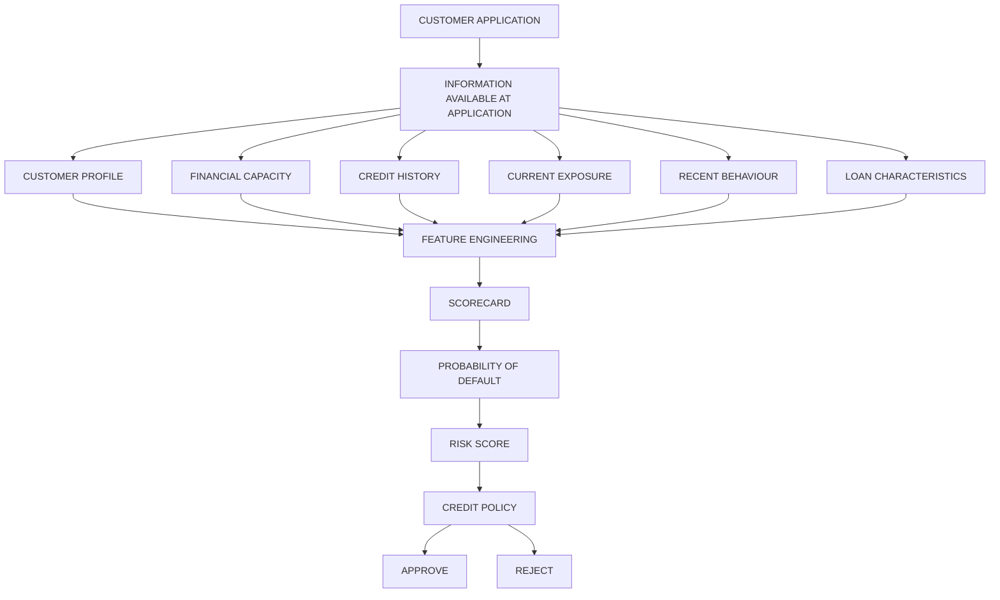

# Our Journey

We can work through the pipeline roughly like this:

## 1. Business Understanding

* What is an application scorecard trying to predict?
* Define How to we make Decesion Approve or Reject Loan application 

## 2. Data Understanding

* Applicant/application variables
* Feature = Customers demogrphaics, finananical capacpity , credit history
* Target = default (0,1)

## 3. Data Cleaning 

* Duplicates Values
* Missing-value treatment
* Outliers

## 4. Exploratory Data Analysis

* Univariate Cateogrical analysis -> countplot and piechart
* Univariate Numerical analysis -> histogram and boxplot
* Heatmap

## 5. feature engerning

* Avoiding leakage
* Train/test split
* Binning
* **WoE (Weight of Evidence)**
* **IV (Information Value)**
* Relationship between variables and default risk

## 6. Logistic Regression Scorecard

* Logistic regression
* Coefficients
* WoE variables
* Odds / log-odds
* Converting model output into a score

## 7. Scorecard Scaling

For example:

> **Score = 600 + PDO × log₂(Odds / Base Odds)**

We'll understand exactly **why** this formula works rather than memorizing it.

## 8. Model Validation

* AUC / Gini
* KS
* ROC
* Calibration
* Train vs. validation performance
* Stability

## 9. Credit-Risk Validation

* PSI
* Characteristic stability
* Population drift
* Reject/inference considerations where relevant

## 10. Final Scorecard

* Points per variable/bin
* Total applicant score
* Risk grades/bands
* Estimated probability of default

## 11. Business Interpretation

* How a bank could use the score
* Cut-off selection
* Approval/rejection strategy
* Expected bad rate
* Trade-off between approval rate and risk

---

### Most Important Principle

I'll keep asking:

> **“What does this mean from a credit-risk/business perspective?”**

rather than letting the project become:

> `Python → model.fit() → AUC → finished.`

For example, if you ask **“Why do we use WoE?”**, we'll connect:

**Raw variable - risk relationship - bins - WoE - logistic regression - odds - scorecard points - lending decision.**

You can ask me questions **one step at a time as you build the project**, including very basic doubts. I'll explain the concept, the statistical reasoning, the implementation logic, and—where useful—the industry perspective.

**Start with your first question/step in the project.**
