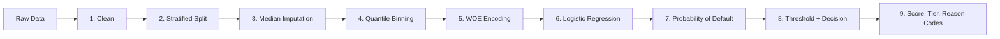

# 🏦 Credit Risk Application Scorecard

An end-to-end Machine Learning web application that estimates an applicant's **Probability of Default**, **Credit Score**, **Risk Tier** and **Approve / Review / Reject decision**, and explains *why* using reason codes. Built as a Weight of Evidence (WOE) + Logistic Regression scorecard.

[](https://credit-risk-application-scorecard-manish.streamlit.app/)


---

## 📋 Table of Contents
1. [Project Overview & Problem Statement](#-project-overview--problem-statement)
2. [Data Overview](#-data-overview)
3. [Exploratory Data Analysis (EDA)](#-exploratory-data-analysis-eda)
4. [Methodology](#-methodology)
5. [Machine Learning Modeling & Evaluation](#-machine-learning-modeling--evaluation)
6. [Project Architecture](#-project-architecture)
7. [Live Demo](#-live-demo)
8. [Usage Guide](#-usage-guide)
9. [Limitations & Production Considerations](#-limitations--production-considerations)

---

## 🎯 Project Overview & Problem Statement

### The Business Challenge
Before disbursing a loan, a bank must decide whether the applicant will repay. This is called **application scoring**. Banks prefer scorecards built on logistic regression because every decision must be explainable to the applicant and to regulators (adverse-action reason codes).

### Understanding the Target Variable (`default_flag`)
* `0` = applicant repaid, `1` = applicant defaulted
* The target is **imbalanced**: 78.1% non-default vs 21.9% default, which is realistic for unsecured retail lending.

### The Solution
The app converts raw applicant information into a probability of default, a points-based credit score, a risk tier and a decision. A bar chart shows which features pushed the application toward approval or rejection.

> ⚠️ **Disclaimer:** The model is trained on a **public, simulated dataset** ([Credit Risk Dataset by Lao Tse, Kaggle, CC0](https://www.kaggle.com/datasets/laotse/credit-risk-dataset)) because real bank bureau data is not publicly available. This project demonstrates **methodology**, not a production credit model. Do not use it for real lending decisions.

---

## 📊 Data Overview

**Source:** Credit Risk Dataset (Lao Tse, Kaggle, CC0) · **Size:** ~32.4k rows after cleaning · **11 features + 1 target**

| Category | Variables |
| :--- | :--- |
| Demographics | `age`, `home_ownership`, `employment_years` |
| Financial | `annual_income` |
| Loan Information | `loan_purpose`, `loan_amount`, `interest_rate` |
| Credit Bureau | `credit_grade`, `credit_history_years`, `prior_default_flag` |
| Derived ratio | `loan_income_ratio` (loan amount ÷ annual income) |
| Target | `default_flag` |

| Type | Columns |
| :--- | :--- |
| Numerical (7) | `age`, `annual_income`, `employment_years`, `loan_amount`, `interest_rate`, `loan_income_ratio`, `credit_history_years` |
| Categorical (4) | `home_ownership`, `loan_purpose`, `credit_grade` (ordinal A–G), `prior_default_flag` |

Missing values: `employment_years` (2.75%) and `interest_rate` (9.55%).

---

## 🔎 Exploratory Data Analysis (EDA)

* Univariate plots: histogram + KDE + boxplot for numerical columns, countplot + pie for categorical columns.
* `age`, `annual_income`, `employment_years` and `loan_income_ratio` are strongly right-skewed.
* **Data errors found:** `age` up to 144 and `employment_years` above 120, which are impossible values.
* `interest_rate` is bimodal, reflecting grade-based pricing tiers. `loan_amount` is multimodal around standard loan sizes.
* `credit_grade` shows a monotonic rise in default rate, from about 10% (A) to about 98% (G).
* `prior_default_flag = Y` roughly doubles the default rate (about 38% vs 18%).

---

## 🔍 Methodology

Every step that learns from data is **fit on the training set only**, then applied unchanged to the test set and to live app input.



### 1. Data Cleaning
- Removed 165 exact duplicate rows (no ID column, full-row match)
- Removed impossible values (`age ≥ 100`, `employment_years ≥ age`)
- Dropped only the most extreme `annual_income` outliers. The remaining skew is absorbed by binning.
- Done **before** the split, because these are rule-based corrections, not data-derived statistics

### 2. Train-Test Split
- 80/20 split, **stratified** on `default_flag`, so both sets keep the ~22% default rate
- Imputation, binning, WOE and the model are fit on the training set only, which prevents leakage

### 3. Missing Value Handling: Median Imputation
- `employment_years` and `interest_rate`
- Median is robust to the skew in `employment_years` and the tails in `interest_rate`
- Medians are learned from the training set and reused on test and live input

### 4. Quantile Binning
- Each numerical feature is cut into 10 **equal-frequency bins** (`EqualFrequencyDiscretiser`, q=10)
- Chosen over decision-tree binning (tiny pure bins crashed the WOE calculation) and equal-width binning (sparse bins on skewed data)
- Every bin was checked to contain both Good and Bad cases
- Bad-rate **monotonicity** across ordered bins was checked, because a zigzag pattern makes a logistic coefficient unreliable
- Categorical variables are already discrete groups and skip binning

### 5. Weight of Evidence (WOE) Encoding
Each bin or category is replaced by its WOE, putting every feature on a common numeric scale. With `feature-engine` and a default target of 1:

$$WOE_i = \ln\left(\frac{\%Bad_i}{\%Good_i}\right)$$

**Higher WOE = riskier bin.** Information Value ranks feature strength:

$$IV = \sum_i (\%Bad_i - \%Good_i) \times WOE_i$$

| IV | < 0.02 | 0.02–0.1 | 0.1–0.3 | 0.3–0.5 | > 0.5 |
| :--- | :---: | :---: | :---: | :---: | :---: |
| Power | Not useful | Weak | Medium | Strong | Suspicious, check for leakage |

WOE and IV are learned from the training set and `y_train` only.

### 6. Logistic Regression
$$\ln\left(\frac{p}{1-p}\right) = \beta_0 + \beta_1 WOE(x_1) + \dots + \beta_n WOE(x_n)$$

- Industry standard for scorecards, because every coefficient can be explained to applicants and regulators
- Binning has already handled non-linearity, so a linear model on WOE inputs works well
- All coefficients are positive, as expected, because higher WOE means higher default risk

### 7. Probability of Default (PD)
$$PD = \frac{1}{1 + e^{-(\beta_0 + \sum \beta_i \cdot WOE_i)}}$$

### 8. Threshold & Decision
- The reject threshold is the **F2-optimal point on the Precision-Recall curve**. F2 weights recall higher, because a missed defaulter costs more than a wrongly rejected good applicant.
- The approve threshold is set at half the reject threshold.

| Condition | Decision |
| :--- | :---: |
| PD ≥ 0.18 (reject threshold) | REJECT |
| PD ≤ 0.09 (approve threshold) | APPROVE |
| In between | REVIEW |

### 9. Credit Score, Risk Tier & Reason Codes
- **Score:** $Score = Offset + Factor \times \ln(odds)$, where $odds = (1-PD)/PD$, Offset = 600 and PDO = 20 (Factor = 20 / ln 2 ≈ 28.9). A score of 600 corresponds to PD = 50%, and every +20 points doubles the odds of being Good.
- **Risk tier:** LOW (PD < 15%), MEDIUM (15% to 40%), HIGH (≥ 40%)
- **Reason codes:** each feature's contribution is `WOE × coefficient`. Positive values push toward default (red) and negative values push toward repayment (green).

---

## 🤖 Machine Learning Modeling & Evaluation

### Final Model Performance (Test Set)
| Metric | Value |
|---|---|
| AUC | 0.87 |
| Gini | 0.75 |
| KS Statistic | 0.22 |
| Threshold (F2-optimal) | 0.18 |


### Information Value (IV) Ranking
| Rank | Variable | Information Value (IV) | Initial Interpretation |
|---:|---|---:|---|
| 1 | `credit_grade` | 0.8821 | Very high predictive separation; investigate feature provenance |
| 2 | `loan_income_ratio` | 0.8777 | Very high predictive separation |
| 3 | `interest_rate` | 0.6530 | Very high predictive separation; investigate feature timing |
| 4 | `annual_income` | 0.4677 | Strong predictive separation |
| 5 | `home_ownership` | 0.3815 | Strong predictive separation |
| 6 | `prior_default_flag` | 0.1486 | Medium predictive separation |
| 7 | `loan_purpose` | 0.0906 | Weak predictive separation |
| 8 | `loan_amount` | 0.0875 | Weak predictive separation |
| 9 | `employment_years` | 0.0570 | Weak predictive separation |
| 10 | `age` | 0.0125 | Very weak predictive separation |
| 11 | `credit_history_years` | 0.0044 | Very weak predictive separation |

### Leakage & Redundancy Investigation
`interest_rate` and `credit_grade` both showed very high IV. [Add the result of `groupby('credit_grade')['interest_rate'].describe()` here.] In the app, the interest rate is derived from the selected grade, because a real applicant does not know their rate in advance.

### Class Imbalance
Logistic regression coefficients are fairly robust to imbalance, but the default 0.5 threshold is not. The threshold was tuned as described in Methodology step 8, and AUC, Gini and KS are the primary metrics (not accuracy).

The fitted imputer, binner, WOE encoder, model and config are serialized in `03_models/` using `pickle`.

---

## 📁 Project Architecture

```text
credit-risk-application-scorecard/
│
├── 01_data/                # Cleaned dataset (credit_risk_clean.csv)
├── 02_notebooks/           # EDA and model-building notebooks
├── 03_models/              # Serialized artifacts (.pkl files)
│   ├── median_imputer.pkl
│   ├── binner.pkl
│   ├── woe_encoder.pkl
│   ├── logreg_model.pkl
│   ├── config.pkl              # thresholds, score constants, dropdown options
│   └── evaluation_metrics.pkl  # pre-computed metrics for the dashboard tab
├── assets/                 # demo GIF / screenshots
├── .gitignore
├── README.md
├── app.py                  # Streamlit web application
└── requirements.txt
```

---

## 🚀 Live Demo

Try the app: [Streamlit Cloud App](https://credit-risk-application-scorecard-manish.streamlit.app/)


---

## 📖 Usage Guide

1. Open the live link, or run locally:
```bash
   git clone https://github.com/YOUR-USERNAME/credit-risk-application-scorecard.git
   cd credit-risk-application-scorecard
   pip install -r requirements.txt
   streamlit run app.py
```
2. **Tab 1: Predict & Explain.** Fill in the form:
   * Demographics: Age, Home Ownership, Employment Length
   * Financial & Loan: Annual Income, Loan Amount, Loan Purpose
   * Credit Bureau: Credit Grade, Prior Default, Credit History Length
3. Read the **Probability of Default, Credit Score, Risk Tier and Decision**, plus the gauge and the reason-code chart.
4. **Tab 2: Model Dashboard.** View AUC, Gini, KS, the IV ranking, ROC / PR curves, the KS chart, the confusion matrix and the calibration curve.

---

## 🚧 Limitations & Production Considerations

* **Synthetic data:** real-world performance would be lower and noisier.
* **Threshold chosen on the test set:** test metrics are slightly optimistic. A stricter design would pick the threshold from cross-validated training predictions.
* **Imputation:** a single global median is used. A grade-wise median for `interest_rate` would preserve the grade → rate relationship better.
* **Interest-rate mapping:** the app derives the rate from the selected grade using [grade medians from the training data].
* **No reject inference:** real scorecards must handle declined applicants whose outcomes are never observed.
* **No PSI monitoring:** production scorecards track score drift over time, which needs time-based data.

---

## 👤 Author

**Manish Deswal**  
B.Sc. (Hons) Physical Science in Mathematics, Ramjas College, University of Delhi.

Interested in data science, statistical modelling, and credit risk analytics.

- **GitHub:** [Manish Deswal](https://github.com/manish-singh-deswal)
- **LinkedIn:** [Connect with me](https://www.linkedin.com/in/manish-deswal/)